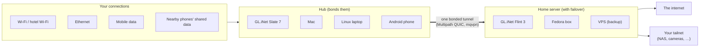

<h1>
  <picture>
    <source media="(prefers-color-scheme: dark)" srcset="assets/brand/tailbond-wordmark-dark.svg">
    
  </picture>
</h1>

[](https://github.com/kaovilai/tailbond/actions/workflows/ci.yml?query=branch%3Amain)
[](https://github.com/kaovilai/tailbond/actions/workflows/auto-release.yml)
[](https://github.com/kaovilai/tailbond/actions/workflows/pages.yml)
[](https://github.com/kaovilai/tailbond/actions/workflows/probe-ios-paths.yml)
[](https://github.com/kaovilai/tailbond/releases/latest)
[](https://github.com/kaovilai/tailbond/releases)
[](https://github.tig.pw/tailbond/)
[](LICENSE)
[](agent/go.mod)
[%20%C2%B7%20Android%20%C2%B7%20iOS%20(Share)-C6F432?labelColor=071A1D)](#platforms)

**Download:**
[](https://github.com/kaovilai/tailbond/releases/latest/download/tailbond-android.apk)
[](https://github.com/kaovilai/tailbond/releases/latest/download/tailbond-glinet-aarch64_cortex-a53_neon-vfpv4.ipk)
[](https://github.com/kaovilai/tailbond/releases/latest/download/tailbond-server.x86_64.rpm)
[](https://github.com/kaovilai/tailbond/releases/latest)
[](https://github.com/kaovilai/tailbond/releases/latest/download/tailbond-macos-arm64.tar.gz)
[](https://github.com/kaovilai/tailbond/releases)  
Built files live only on [GitHub Releases](https://github.com/kaovilai/tailbond/releases) (checksums in `SHA256SUMS`); each guide below starts with its download. Each merge to `main` that passes CI is tagged automatically, and the release is published once that tag's own CI run passes; to try unreleased changes, [build from source](#build-from-source). The iPhone's tailbond Share app is build-from-source only (free Apple ID signing, [iOS](docs/ios.md)).

**Deploy a server:**
[](docs/deploy.md#any-vps-cloud-init)
[](docs/deploy.md#docker--podman)
[](docs/deploy.md#kubernetes)
[](docs/deploy.md#flyio)
[](https://github.com/kaovilai/tailbond/pkgs/container/tailbond)  
The server image (amd64, arm64) is CI-tested in Podman, Docker Compose and a kind cluster; cloud-init and Fly.io are untested templates. Heroku, Vercel, Cloudflare and Railway can't host a server (no inbound UDP or TUN); see [docs/deploy.md](docs/deploy.md).

**Speedify-style bonding to your own server:** tailbond joins Wi-Fi, mobile data, Ethernet and nearby phones into one faster, steadier tunnel to a server you run, with your [Tailscale](https://tailscale.com) tailnet reachable through it.

> **Status: early.** Every part is built and tested in CI: unit tests, network-namespace end-to-end tests, an OpenWrt install test in a container, an Android emulator test, macOS runner tests with the Mac as hub (against a Linux server VM) and as server (with a Linux client VM), an [accessibility check](docs/accessibility.md) of every web page, and simulated user testing. On real hardware, only the **GL.iNet Flint 3 as a home server** has run so far; travel routers, phones, Macs and VPSes have not. Expect rough edges and please [file issues](https://github.com/kaovilai/tailbond/issues/new/choose).

## How it works



The data plane is [mqvpn](https://github.com/mp0rta/mqvpn) (MASQUE CONNECT-IP over Multipath QUIC) with small [patches](patches/mqvpn/). tailbond adds the agent (`tailbondd`), the web and router UIs, the apps, Tailscale integration, pairing and packaging. Details: [architecture and API contract](docs/architecture.md).

## Features

- **Bonding modes:** Fastest (all links together), Smooth calls and video, Most reliable (every packet twice), Save mobile data (backup-only links and monthly caps).
- **Tailscale-native:** devices find the home server over Tailscale, ask to connect and you tap Approve; the tailnet's machines stay reachable by their MagicDNS names, with a machines list on every hub.
- **Home + VPS failover:** an ordered server list; switches after 15 s of outage and fails back after 2 min healthy.
- **Bypass rules (router):** chosen websites, devices, addresses or ports go direct or through one chosen link.
- **Hotel Wi-Fi:** captive-portal detection and sign-in that works with GL.iNet's own repeater Login Mode.
- **[Pair & Share](docs/pair-and-share.md):** Android phones and iPhones (the free-signed tailbond Share app) lend their mobile data over Wi-Fi to the hub, which bonds it with its own links. A Mac or Linux laptop can lend its Ethernet, a second Wi-Fi adapter or a USB modem the same way.
- **[Mac as the home server](docs/macos.md#mac-as-home-server):** a Mac that stays at home ends the bonded tunnel, NATs to the internet and your tailnet with its own firewall (pf), and keeps itself awake while serving.
- **[Mac as the hub](docs/macos.md):** a MacBook bonds its Wi-Fi, an Ethernet or USB-C adapter, an iPhone over USB and nearby phones' shares; a [menu bar app](docs/macos.md#menu-bar) shows the links, other VPNs and updates.
- **[Next to a work VPN](docs/macos.md#using-tailbond-with-netbird-or-another-work-vpn)** (Mac, Linux client): NetBird, the Tailscale app or another VPN keep their addresses and DNS. tailbond routes only tailnet machines' own addresses and uses split DNS; the work VPN's traffic goes Direct or Bonded.
- **[Phone hub](docs/phone-hub.md):**
  - An Android phone shares its bonded connection with a laptop through a
    proxy, and the Mac's "Use phone hub" points the system proxy at it.
  - Android also bonds nearby phones' shared data itself.
  - On the iPhone this is experimental and not bonded yet.
- **Setup health:** direct-vs-relayed Tailscale peers, CGNAT detection and port reachability, each with how to fix it.
- **[Updates](docs/updates.md) and [backups](docs/backup-restore.md):** GitHub releases with checksums; COPR/dnf on Fedora, one click on VPS, GL routers and Macs, Homebrew, Obtainium on Android; encrypted config backup and restore.
- **"Get tailbond" page:** type the server's name (`homebox/`) in any browser on the tailnet: the app or installer for that device (Android, Mac, iPhone, Linux), with the steps.
- **[Report a problem](docs/reporting.md):** crash capture and a redacted GitHub issue you check first, from the dashboard, the GL panel and both apps. Nothing is sent automatically: no telemetry, no network call; your browser opens the issue form. Security problems go to [private reporting](SECURITY.md).

## Platforms

| Platform | Role | Install | Status |
|---|---|---|---|
| GL.iNet Flint 3 (GL-BE9300) | Home server | [GL.iNet](docs/glinet.md) | CI-tested; **tested on real hardware** |
| Fedora 43+ | Home server | [Fedora](docs/fedora-server.md) (RPM, COPR) | CI-tested |
| Debian, Ubuntu, AlmaLinux / RHEL / Rocky, Fedora (VPS) | Home or backup server | [VPS](docs/vps.md) (`install.sh`, Ansible) | CI-tested |
| Container: Docker, Podman, Kubernetes | Home or backup server | [Deploy](docs/deploy.md) (`ghcr.io/kaovilai/tailbond`) | CI-tested (Podman, kind) |
| GL.iNet Slate 7 (GL-BE3600), OpenWrt 23.05+ aarch64 | Travel router (hub) | [GL.iNet](docs/glinet.md) | CI-tested |
| macOS (Apple silicon) | Hub and sharer | [macOS](docs/macos.md) (`install.sh`, Homebrew) | CI-tested (sharing: over `lo0` on the runner, not a real adapter) |
| macOS (Apple silicon) | Home server | [Mac as home server](docs/macos.md#mac-as-home-server) (`install.sh --role server`) | CI-tested (runner + Linux client VM; not on a real Mac or with a real Tailscale) |
| Linux laptop | Hub and sharer | [VPS guide, `--client`](docs/vps.md#a-linux-laptop-instead-client-role) | CI-tested |
| Android 8+ | Phone (bonds itself) and sharer | [Android](docs/android.md) | CI-tested (emulator) |
| Android TV / Google TV (Android 8+) | Bonds itself, by remote | [Android TV](docs/android.md#android-tv) | CI-tested (TV emulator, remote keys only; no tunnel) |
| iPhone (iOS 16+) | Sharer (tailbond Share) | [iOS](docs/ios.md) | CI-tested (simulator) |

GL.iNet routers can also install and update tailbond from **APPLICATIONS → Plug-ins**, with the signed feed `https://github.com/kaovilai/tailbond/releases/latest/download` as a custom source ([how](docs/glinet.md#install-and-update-from-gls-plug-ins-page)).

More: [coming from Tailscale](docs/coming-from-tailscale.md) · [setup tips for best speed](docs/setup-tips.md) · [updates](docs/updates.md) · [backup and restore](docs/backup-restore.md) · [comparison with OpenMPTCProuter](docs/comparison-openmptcprouter.md) · [brand](docs/brand.md)

## Quick start

1. **Home server:** install on a Fedora box (`sudo dnf copr enable kaovilai/tailbond && sudo dnf install tailbond-server`), a GL.iNet Flint 3 ([GL.iNet](docs/glinet.md)), a Mac that stays at home ([Mac as home server](docs/macos.md#mac-as-home-server)) or a VPS ([VPS](docs/vps.md)), with Tailscale on.
2. **Each device:** with Tailscale on, open **`homebox/`** (your server's Tailscale name, with the slash) in its browser. The "Get tailbond" page has the app or installer and the steps for that device.
3. **Approve** it on the server's page (`http://homebox:8077`). It connects and bonds whatever links it has.

## Build from source

For contributors; to install, use the downloads above. Build outputs go to
`out/` (ignored by git; CI fails if a built file or anything over 1 MB is
committed).

```sh
git clone --recurse-submodules https://github.com/kaovilai/tailbond
cd tailbond
agent/build.sh                          # tailbondd (static, amd64 + arm64)
scripts/build-mqvpn-native.sh           # patched mqvpn for this machine
packaging/fedora/build-rpm.sh           # Fedora RPM → out/rpm/
scripts/build-mqvpn-aarch64-musl.sh && packaging/openwrt/build-ipk.sh   # GL.iNet/OpenWrt → out/ipk/
android/scripts/setup-sdk.sh && android/scripts/build-apk.sh            # Android → out/android/
(cd ios && xcodegen) && open ios/TailbondShare.xcodeproj               # iPhone (macOS, Xcode), see docs/ios.md
scripts/build-mqvpn-macos.sh && agent/build.sh darwin/arm64 && packaging/macos/build-bundle.sh   # Mac → out/macos/ (on a Mac)
scripts/e2e-netns.sh                    # end-to-end test (needs sudo)
scripts/e2e-share.sh                    # Pair & Share end-to-end (needs sudo)
# the two Mac end-to-end tests boot out/e2e-vm/{vmlinuz,initramfs.gz}: build it on an
# arm64 Linux host first (scripts/e2e-macos/build-server-vm.sh, see its header)
scripts/e2e-macos.sh                    # Mac hub end-to-end (on a Mac, sudo, QEMU; docs/macos.md)
scripts/e2e-macos-server.sh             # Mac as server end-to-end (on a Mac, sudo, QEMU)
```

[CI](.github/workflows/ci.yml) builds and tests all of it and publishes releases on `v*` tags, with the same file names in every release (`releases/latest/download/<name>`: [scripts/release/collect-assets.sh](scripts/release/collect-assets.sh)).

## Inspirations and credits

tailbond exists because these projects showed what bonding should feel like.
Here's what each got right, and what tailbond does differently (as of
November 2026; check their sites for current plans).

| Project | What it got right | Where tailbond differs |
|---|---|---|
| [Speedify](https://speedify.com) | Bonding that just works on every platform, plain-language modes, **Pair & Share** (nearby phones lend their data) and a GL.iNet router app. tailbond's modes and Pair & Share follow its lead | A subscription service (a free account includes 5 GB a month, then paid plans) whose traffic exits through Speedify's servers. tailbond is free with no account, and exits from **your** home or VPS. It's Tailscale-native and open source. Speedify is ahead on polish, support, Windows, and iPhones that bond themselves |
| [Peplink SpeedFusion Connect](https://www.peplink.com/services/products-sfc/) | Per-link control (Always, Backup only), hot failover and duplicated packets for calls, on Peplink routers and apps | Peplink's hosted service is sold as data plans. Self-hosting means Peplink's [FusionHub](https://www.peplink.com/services/software/virtual-appliance-fusionhub/) appliance, which is free for one device and licensed beyond that. tailbond has no plans or licences for any number of devices, and runs on hardware you already have (GL.iNet stock firmware, Fedora, a VPS, a Mac, Android). Peplink is ahead on enterprise hardware and support |
| [OpenMPTCProuter](https://www.openmptcprouter.com) | Open source, your own VPS, up to 8 WANs, port forwarding and a public IP | Replaces your router's firmware and has no phone or desktop apps. tailbond installs on stock GL.iNet firmware, adds phone and Mac hubs and Pair & Share, and is built around Tailscale. Full comparison: [docs/comparison-openmptcprouter.md](docs/comparison-openmptcprouter.md) |
| [Tailscale](https://tailscale.com) | Zero-config identity, MagicDNS, a machine list, one-tap simplicity. tailbond's apps copy its layout, and pairing uses your tailnet | Tailscale uses one path at a time and doesn't bond links. tailbond adds the bonding and leaves your tailnet as it is ([coming from Tailscale](docs/coming-from-tailscale.md)) |

Built on:

- **[mqvpn](https://github.com/mp0rta/mqvpn)** by mp0rta: MASQUE CONNECT-IP over Multipath QUIC, the engine that carries every bonded packet. tailbond adds patches for client stats, Pair & Share relay paths and macOS ([patches/mqvpn](patches/mqvpn)).
- **[iOS-SOCKS-Server](https://github.com/nneonneo/iOS-SOCKS-Server)** by nneonneo: showed that an iPhone can share its connection from an ordinary app, with no paid developer account. That idea became the iPhone Share app and the phone hub.
- **[Obtainium](https://obtainium.imranr.dev/)**, for hands-off Android updates straight from GitHub Releases.
- Notes from the GL.iNet and OpenWrt communities on package formats and GL's firmware ([docs/glinet.md](docs/glinet.md)).
- The libraries in [NOTICE](NOTICE).

In short, tailbond is **free, with no subscription or account, runs on your own stack, and is Tailscale-native.** Your traffic goes to your server and leaves from your IP, and your tailnet comes along.

## Contributing

- **Issues:** use the [issue forms](https://github.com/kaovilai/tailbond/issues/new/choose) ([bug](.github/ISSUE_TEMPLATE/bug_report.yml), [feature](.github/ISSUE_TEMPLATE/feature_request.yml)). Take pairing links, keys and addresses you don't want public out of logs first.
- **`autofix`:** a maintainer adds the `autofix` label to an issue they've read, and an AI agent ([workflow](.github/workflows/issue-autofix.md)) drafts a fix PR checked with the repo's own tests; a maintainer's own new issues get one right away. Nothing merges without review.
- **Dependencies:** [Dependabot](.github/dependabot.yml) opens one grouped PR a week for Go modules, Gradle and GitHub Actions; security updates come separately.
- **[SBOM](docs/sbom.md):** every release has an attested SPDX SBOM of each file, down to the C libraries inside mqvpn; main's build is submitted to the dependency graph, so Dependabot alerts cover what ships.
- Commits carry a DCO sign-off (`git commit -s`).

## Security

Please report vulnerabilities privately through GitHub's [private vulnerability reporting](https://github.com/kaovilai/tailbond/security/advisories/new), not in a public issue: [SECURITY.md](SECURITY.md).

## License

[Apache-2.0](LICENSE). See [NOTICE](NOTICE) for third-party software. Tailscale, GL.iNet, Speedify, Peplink and SpeedFusion are trademarks of their respective owners; tailbond is not affiliated with them.
