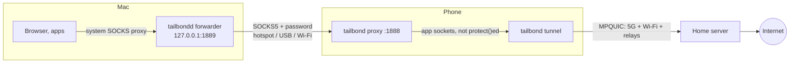
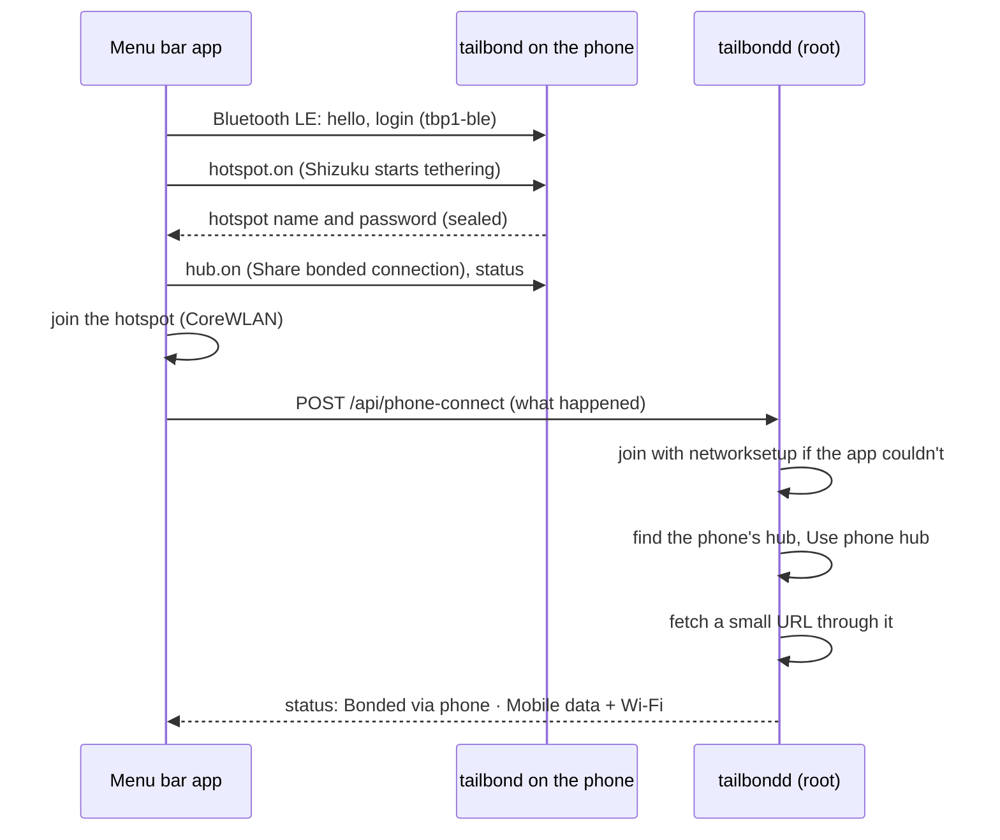

# Phone hub: share a phone's bonded connection

A phone running tailbond bonds its own connections (mobile data, Wi-Fi,
nearby phones' shared data) into one tunnel to your home server. With
**phone hub**, a laptop next to it uses that bonded connection too: the
phone runs a small proxy, and the laptop's apps go through it.

This differs from [Pair & Share](pair-and-share.md). Pair & Share lends a
phone's mobile data to another device's tunnel, as one more path. A phone
hub lends the phone's whole tunnel, already bonded, to a device that runs
no tunnel of its own, or whose own connections are poor.

## When to use which

| You have | Use |
|---|---|
| A Mac with tailbond, and a phone with mobile data | Pair & Share: the Mac bonds the phone's data with its own Wi-Fi |
| A Mac at a hotel, and an Android phone already bonding 5G + the hotel Wi-Fi | **Phone hub**: Mac → phone's hotspot, "Use phone hub" |
| An iPhone over USB, Personal Hotspot on | **Phone hub** (experimental) or the plain USB path in [macos.md](macos.md) |
| A device without tailbond (a TV, a games console) | Neither: a [GL.iNet travel router](glinet.md) |

## The protocol

- **Proxy:** SOCKS5 (RFC 1928) and an HTTP CONNECT proxy on one TCP port,
  **1888**.
  - SOCKS5 supports CONNECT only. UDP ASSOCIATE is refused with reply
    code 7 (see *Limits*).
  - The reference implementation is `agent/internal/proxy`. The Android
    (`ProxyServer.kt`) and iPhone (`TailbondShareKit`) servers follow it.
- **Login** (Pair & Share's keys, [architecture.md](architecture.md#pair--share)):
  - Every paired device has its own share key. A hub (the Mac) gets a pass
    from the home server for each other device: `PassKey(that device's
    key, hub name, expiry)`, the same pass it uses for that device's relay.
  - The user is `<hub name>/<expiry>`, e.g. `dana-macbook/1793836800`.
  - The password is the first 16 characters of
    `base32(HMAC-SHA256(pass, "tbp1-proxy"))`, lower case, with no padding.
  - The phone re-derives the pass from its own key and the user's hub name
    and expiry, and checks it offline. An expired pass, another device's
    pass, or a hub not on the phone's allowed list is refused. A removed
    device gets no new passes, so its access ends within two days.
  - There is nothing to set up: a Mac paired with the same home server has
    its passes already.
  - `agent/internal/proxy/testdata/vectors.json` pins the derivation for
    all three implementations.
- **Who may connect:**
  - Only private, CGNAT, link-local and loopback source addresses (RFC 1918,
    100.64/10, fe80::/10, ULA).
  - The hub listens only on its hotspot, USB and Wi-Fi interfaces, never on
    mobile data.
- **Discovery:**
  - mDNS service `_tailbond-proxy._tcp`, with the TXT keys of Pair & Share
    (`id`, `label`, `kid` = the phone's share key id, which tells the hub
    which pass to use).
  - Also the home server's registry `POST /api/shares` with `"kind":
    "proxy"`. Pair & Share hubs ignore those entries.
- **Upstream:** the proxy's outgoing sockets are the phone app's own. The
  app never `protect()`s them (Android) or binds them to an interface
  (iPhone), so they go into the phone's tunnel like any other app's
  traffic.

## Android: Share bonded connection

**tailbond → Settings → Sharing → Share bonded connection** turns it on. A foreground
service keeps running with a notification. The notification shows the
devices and bytes (*Sharing bonded connection with 1 device: 42 MB*) and
has **Stop sharing**.

- **Listening:** port 1888 on every interface. A connection is served only
  if it arrives on a LAN address: hotspot, USB tethering, Bluetooth, Wi-Fi,
  or loopback for adb. Connections arriving on mobile data or the VPN are
  refused. The source must be private or link-local, and the password must
  match.
- **Upstream:** each connection is opened on tailbond's VPN network
  (`Network.socketFactory`, names resolved there too), and the sockets are
  never `protect()`ed. The laptop's traffic goes into the bonded tunnel:
  mobile data, Wi-Fi and nearby phones' shares together. If tailbond isn't
  connected, nothing goes out (*Waiting for tailbond to connect*).
- **Discovery:** NSD advertises `_tailbond-proxy._tcp`. Every minute the
  phone also tells the home server its LAN addresses (`kind: "proxy"`).

### Android as a Pair & Share hub

The Android app can also be the hub itself. Phones on the same Wi-Fi that
share their mobile data (`_tailbond-share._udp`, or the home server's list)
become extra paths of the phone's own tunnel, as on a travel router or a
Mac ([pair-and-share.md](pair-and-share.md)). To turn it off, use **Share →
Use nearby phones' shared data**.

How it works:

- **mqvpn's relay paths:** patch 0002's `set_relay`, plus patch 0004, which
  adds `mqvpn_android_reactor_add_relay_path`.
- **The patched native build:** `android/scripts/build-native.sh` builds
  libmqvpn and the JNI from a patched copy of `third_party/mqvpn`.
- **The hub's link:** `ShareLink` is a Kotlin port of `link.go`, tested
  against the Kotlin sharer.
  - Its LAN socket is bound to Wi-Fi and kept out of the VPN.
  - A ready link becomes the path `sh` + 6 hex digits, named as tailbondd
    names it.
  - A link that stops answering for 3.5 s is dropped from the bond.

So a phone at a hotel can bond its own 5G, the hotel Wi-Fi and a friend's
phone's 5G, and then share that whole bond with the laptop.

## Mac: Use phone hub

**Dashboard → Connections → "Use a phone's connection"** lists the
hubs found. **Use** turns it on; the card then says *"Using Pixel's bonded
connection (proxy)"* with the traffic so far. **Stop using it** turns it
off.

What happens:

1. tailbondd starts a forwarder on **127.0.0.1:1889**. It takes SOCKS5 and
   HTTP CONNECT with no password, from loopback only, and relays each
   connection to the phone with the derived password. The forwarder exists
   because:
   - Chrome and most apps ignore a SOCKS password in the system settings;
   - the phone's address may be IPv6 link-local with a zone
     (`fe80::1c3e:…%en0`), which `networksetup` can't take;
   - when the phone's address changes (a new hotspot session, or iOS
     rotating its Private Wi-Fi Address), only the forwarder's upstream
     changes.
2. The system SOCKS proxy of the network service that carries the default
   route (Wi-Fi, iPhone USB, Ethernet…) is pointed at the forwarder:
   `networksetup -setsocksfirewallproxy <service> 127.0.0.1 1889`.
   - First, the previous setting is saved to `state_dir/phone-hub-proxy.json`
     (the restore record).
   - If the default route moves to another service, the setting follows it,
     and the first service gets its own setting back.
3. **Proxy auto-config (on by default):** *"Keep home, local and
   Tailscale addresses on this Mac's own network (recommended)"* is ticked
   unless you untick it before **Use**.
   - The service's auto-proxy URL becomes
     `http://127.0.0.1:8077/proxy.pac`.
   - That file sends plain host names, `.local`, `.ts.net`, `.home.arpa`,
     private, CGNAT, link-local and IPv6 literals DIRECT, and everything
     else to the forwarder.

**Putting it back:**

- When you stop using the hub, the saved setting comes back exactly: a
  SOCKS server you had before, on or off, or your own PAC URL. The card
  then reminds you that the Mac may still be on the phone's hotspot:
  rejoin your usual Wi-Fi and turn the hotspot off.
- When tailbondd stops normally, it puts the setting back on the way out.
- If tailbondd crashes, is killed or the Mac loses power, the setting stays
  until tailbondd starts again. Its LaunchDaemon starts it at boot and
  `KeepAlive` restarts it after a crash. It then reads the restore record
  and puts the setting back before anything else.
- "Use phone hub" is deliberately **not** remembered across restarts. A
  phone that has gone away must not leave the Mac without internet, so you
  pick it again.
- If the phone isn't found for 3 rounds (about 45 s), tailbondd stops using
  it, puts the setting back and says *"Lost the phone hub, so the proxy is
  off again and this Mac uses its own connection."*

**How the Mac finds the phone,** best first. Every address is tried with the
password before it is listed, and found again each round; nothing is
cached across sessions.

1. **mDNS** `_tailbond-proxy._tcp` on the Mac's LAN interfaces.
2. **The home server's list.** These are phones that registered `kind:
   "proxy"` with an address on one of the Mac's subnets. This needs the
   Mac's tunnel, or its last list.
3. **The hotspot's router,** when neither of the above finds one:
   - the IPv6 link-local routers from `ndp -rn`, with their zone.
     `networksetup`'s "IPv6 Router" is often empty or stale on a phone
     hotspot.
   - the IPv4 default gateway, **except 192.0.0.x**. That is the CLAT
     address an iPhone hotspot on an IPv6-only carrier hands out, and
     nothing listens there.
   - **172.20.10.1** when the Mac has an address in 172.20.10.0/28 (an
     iPhone hotspot) but the gateway isn't the default route right now.

Discovery runs only while the dashboard or the menu-bar app is open, or a
hub is in use. An idle Mac sends nothing.

**Other machines (Linux):** tailbondd runs the forwarder but doesn't change
the system proxy. The card says *"Set your apps' SOCKS5 proxy to
127.0.0.1:1889"*.

API:

- `GET /api/phone-hub` returns `{found: [{id, label, addr, via}], using:
  {label, addr, mode, service, local, up_bytes, down_bytes, conns}, note,
  manual}`.
- `POST /api/phone-hub` takes `{"use": "<id>", "pac": false}`, `{"use": ""}`
  to stop, or `{"refresh": true}`.
- `GET /api/status` includes the same object as `phone_hub`.

## One click from the Mac

**Menu bar → Phone → Connect via phone** goes from "phone in my pocket" to
"this Mac on the phone's bonded connection" in one click. Click again to
stop.

What you need:

- **On the phone:** tailbond → Share → **One click from your Mac** on (it
  asks for *Nearby devices*, Android's Bluetooth permission), and
  [Shizuku](https://shizuku.rikka.app/) running, with tailbond allowed in it
  (the card has **Allow in Shizuku**). Shizuku runs with wireless debugging,
  no root; Android doesn't let an ordinary app start the hotspot. Starting
  the hotspot needs Android 11 or newer.
- **On the Mac:** the menu bar app, allowed to use Bluetooth (macOS asks on
  the first click), and the Mac and the phone paired with the same home
  server. There is no Bluetooth pairing and no code to type: both already
  hold what the login needs.

What happens, step by step (each failure names its step in the menu):

1. **Bluetooth:** the app finds the phone (GATT service
   `5f1d0001-7462-4e64-8f6c-7461696c626f`) and logs in.
2. **Hotspot:** `hotspot.on`. The phone starts Wi-Fi tethering through
   Shizuku with the hotspot name and password set in Android's settings
   (tailbond changes neither) and sends them back.
3. **Phone hub:** `hub.on` turns on Share bonded connection; `status`
   gives the battery, the phone's bonded links (*Mobile data + Wi-Fi*) and
   their count, for the menu.
4. **Wi-Fi:** the app joins the hotspot with CoreWLAN. When it can't (macOS
   refuses, or the network isn't seen yet), tailbondd joins with
   `networksetup -setairportnetwork` as root.
5. **Find, use:** tailbondd looks for that phone's hub (by its id, from the
   Bluetooth hello) with the usual discovery, for up to 45 s, and uses it as
   the dashboard's **Use** does: the forwarder on 127.0.0.1:1889 and the
   system proxy, with the PAC file (local, home and tailnet names direct).
6. **Internet:** tailbondd fetches
   `http://connectivitycheck.gstatic.com/generate_204` through the
   forwarder. If nothing comes back, it stops using the hub, puts the proxy
   settings back and says so.

The menu then says **Bonded via phone · Mobile data + Wi-Fi** (the phone's
bonded links), with the phone's name, battery and path count.

**Clicking again** stops using the hub: the proxy settings come back exactly
as before (the same restore record as **Stop using it**). The app tells the
phone `hub.off`. The phone's hotspot stays on, and the Mac stays on it; **…and
turn off its hotspot** also sends `hotspot.off`.

**Without Bluetooth** (off, not allowed, no Bluetooth LE, or no phone
answers), the same click uses a phone hotspot this Mac is on already: you
turn on the hotspot and Share bonded connection yourself and join it, then
click. The menu says *No Bluetooth: … Used the phone hotspot this Mac is
on.* A phone without Shizuku works this way too.

### The Bluetooth protocol

The reference is `agent/internal/bleproto`. `testdata/vectors.json` pins it
for the Kotlin (`android/.../ble/BleProtocol.kt`) and Swift
(`macos/TailbondMenu/.../PhoneProtocol.swift`) sides.

- **GATT:** the Mac writes to RX (`5f1d0002-…`), the phone notifies on TX
  (`5f1d0003-…`). Every message is a 2-byte length and up to 4096 bytes,
  cut into pieces of the ATT payload (MTU − 3).
- **Login:** the pass the home server gave the Mac for the phone (as for the
  proxy, *The protocol* above), under its own label: the secret is the
  first 16 characters of `base32(HMAC-SHA256(pass, "tbp1-ble"))`, lower
  case, so the Bluetooth and proxy credentials differ. The user is
  `<hub name>/<expiry>`.
  1. `hello` both ways, each with a 16-byte nonce. The phone's also carries
     its hub id, its name and its share key id (which login to use).
  2. `auth`: the Mac's `HMAC(secret, "tbp1-ble-auth|cn|sn|user")`. The phone
     re-derives the pass from its own key and checks it offline, as for the
     proxy: an expired pass, another server's Mac or a hub not on the
     phone's allowed list is refused, and the phone drops the connection.
  3. The phone answers with `HMAC(secret, "tbp1-ble-phone|cn|sn|user")`, so
     the Mac knows it is the phone and not something pretending to be one.
- **After the login** every message is sealed with AES-256-GCM, key
  `HMAC(secret, "tbp1-ble-session|cn|sn|user")`, nonce = direction, three
  zero bytes, a 64-bit counter per direction. The hotspot password never
  crosses Bluetooth in clear; a replayed, reordered or changed message ends
  the session.
- **Commands:** `hotspot.on`, `hotspot.off`, `hotspot.state`, `hub.on`,
  `hub.off`, `status`. Anything before the login, or an unknown command, is
  refused. Refusals carry a code: `shizuku` (not running, or tailbond not
  allowed), `unsupported` (Android older than 11), `hotspot` (Android
  refused tethering), `hub`, `unknown`, `auth`.
- **tailbondd's half:** `GET /api/phone-connect/keys` gives the app its
  logins (from this Mac only); `POST /api/phone-connect` takes the app's
  result, `{"connect": {"ble": "ok", "phone": {...}, "ssid", "pass",
  "joined"}}` (or `"ble": "off" | "denied" | "unsupported" | "no_phone"` to
  fall back, `"auth" | "hotspot" | "hub"` when the phone refused), and
  `{"disconnect": true}`. `GET /api/phone-connect` and `/api/status`'s
  `phone_hub.connect` say where it is: `{state: idle | working | bonded |
  failed, step, via: bluetooth | hotspot, phone, network, paths, battery,
  error, note}`.

**Windows and Linux:** not yet. The one click is the Mac menu bar app's;
on Linux, tailbondd's phone hub works as before (point apps at
127.0.0.1:1889). Windows is
[issue #28](https://github.com/kaovilai/tailbond/issues/28).

Credit: the Bluetooth-plus-Shizuku idea, and the Android hotspot control
(`ble/HotspotShell.kt`), come from
[Untether](https://github.com/ImOstrovskiy/untether) (BSD-3-Clause; notice in
[THIRD_PARTY_NOTICES.md](../THIRD_PARTY_NOTICES.md)).

## iPhone (experimental)

**Recommended for an iPhone: USB.** Turn on Personal Hotspot and plug the
iPhone into the Mac. tailbond on the Mac bonds **iPhone (USB)** with the
hotel Wi-Fi itself ([macos.md](macos.md)). This needs no app on the iPhone
and is tested.

**tailbond Share → For a Mac → Share mobile data with a Mac** runs the same proxy on
the iPhone (`TailbondShareKit`: `ProxyCore` and `ProxyServer`, with the
same login, checked from the iPhone's own share key). It advertises `_tailbond-proxy._tcp`,
so a Mac finds it like an Android hub. Its advert says `b=0`: the Mac
labels it *mobile data only, not bonded*, and says how to bond an iPhone
over USB instead.

**It is not bonded yet.** The upstream is the iPhone's **mobile data
only** (`DirectDialer(.cellular)`). The bonded tunnel inside the app is
not built, and the app says so. That tunnel would be an mqvpn client
without TUN: free signing can't use Network Extension. It needs:

- mqvpn and xquic built for iOS into the app;
- an in-app TCP/IP stack (lwIP) whose packets go to
  `mqvpn_client_on_tun_packet` and come back from `tun_output`;
- paths over cellular, Wi-Fi and relays.

iOS also pauses the app off-screen, as for tailbond Share
([ios.md](ios.md)). Until that exists, a Mac on a USB-tethered iPhone does
better by bonding it itself.

## Limits

These are true of any proxy, so they are said in the UI, not only here:

- **Only apps that follow the system proxy** use the phone: Safari, Chrome,
  Firefox (by default), most apps that use Apple's networking, `curl` with
  `--socks5-hostname`. Other apps go out over the Mac's own connection.
- **TCP only.** Video calls, games, QUIC (HTTP/3) and VPNs don't go
  through a SOCKS CONNECT proxy. Browsers fall back from HTTP/3 to
  HTTP/2 over TCP when UDP fails, so websites still work.
- **A VPN with a kill switch** on the Mac (or "block local network") can
  drop link-local and LAN traffic, and the Mac then can't reach the phone.
  Allow local network access in that VPN.
- **Battery:** the phone carries all of the Mac's traffic. Keep it on a
  charger, as with any hotspot.

## Tested

| What | Where | Proven |
|---|---|---|
| Proxy protocol, password, refused sources, UDP ASSOCIATE refused, byte counts | `go test ./internal/proxy` | Unit tests, with the vectors |
| Restore record, service detection, SOCKS and PAC set and put back, part-way failure | `go test ./internal/sysproxy` | Unit tests, with a fake `networksetup` |
| Discovery, password check, forwarder, a hub that moves, a hub that goes, PAC, startup restore, idle | `go test ./internal/agent -run PhoneHub` | Unit tests, with fake hubs |
| Mac end to end | CI `macos` job, `scripts/e2e-macos.sh` | See below |
| Android proxy: password, sources, upstream hook, UDP ASSOCIATE refused | `ProxyServerTest` (JVM) | Unit tests, with the Go vectors |
| Android proxy end to end | CI `android-e2e`, `scripts/e2e-android.sh` | On the emulator, through `adb forward`: SOCKS5 and HTTP CONNECT reach a token server that only the tunnel reaches, and it logs the **phone's tunnel address** as the client. A wrong password is refused, and the counters move |
| Android hub link | `ShareLinkTest` (JVM) | Against the Kotlin sharer over loopback: relay both ways, another server's key refused, unreachable, lost |
| Android as a Pair & Share hub | CI `android-e2e` | A Go sharer on the host (10.0.2.2:47077) becomes an active relay path of the app's tunnel, and the sharer relays the phone's bytes. Stopping it drops the path, and the tunnel keeps working |
| iPhone proxy | CI `ios` job, `swift test` | Handshake, the Go vectors, and on macOS curl through the Swift server (SOCKS5 and HTTP CONNECT; wrong password refused) |
| One click: tailbondd's steps | `go test ./internal/agent -run PhoneConnect` | Every failure names its step and leaves the proxy as it was: no phone, Bluetooth denied (falls back), bad login, hotspot refused, hub refused, Wi-Fi join failed, no hub found, hub up but no internet (proxy put back); the second click restores the proxy |
| One click: the Bluetooth protocol | `go test ./internal/bleproto`, `BleProtocolTest` (JVM), `PhoneTests` (`swift test`) | The same vectors in Go, Kotlin and Swift: login, phone proof, session key, sealed messages, chunks for MTU 23 and 185 |
| One click: the phone's side | `BleServerTest` (Robolectric) | A fake GATT peer, fake Shizuku and fake hub: login, every command, chunking, refusals (before login, wrong login, unknown command, replay, Shizuku not running, tethering failed, Android 10, hub not paired) |
| One click: Mac end to end | CI `macos` job, `scripts/e2e-macos.sh` | See below |
| One click: the menu | `swift test` (snapshots `menu-07`…`menu-12`) | The words for idle, bonded, failed, no Bluetooth and the app's Bluetooth stage, and the real tailbondd's status from the e2e decoded and rendered |

What the Mac end-to-end test shows:

- A stand-in phone hub (`tb-sharesim -proxy`, the reference server, on the
  fake-Ethernet LAN) is found.
- **Use** sets the runner's real system SOCKS proxy (`scutil --proxy`).
- `curl` through those values reaches a token that only the tunnel reaches,
  and the hub logs the bytes.
- PAC mode sets the auto-proxy URL.
- Stopping, and `kill -9` followed by a restart, both bring back the exact
  original setting.

For **Connect via phone** the same e2e posts the menu bar app's Bluetooth
result as the app does (there is no Bluetooth radio or phone on a CI
runner), with the stand-in hub as the phone. tailbondd then really finds
it, sets the system proxy (PAC), fetches a token that only the tunnel
reaches through it, and says *bonded*; `curl` through 127.0.0.1:1889 gets
the token; the status is saved and the menu bar's test decodes and renders
it; the second click brings back the exact original proxy setting. The
fallback (no Bluetooth) and a hotspot refusal are run the same way.

The stand-in's upstream is the Mac's own tunnel, so this proves the Mac's
half. The phone's half, its upstream going into its own tunnel, is proven
on the Android emulator.

**Not tested on real devices:**

- a Mac on a real Android hotspot or on iPhone USB tethering, with "Use
  phone hub";
- IPv6 link-local discovery against a real phone;
- NSD between a real phone and a Mac;
- the Android proxy listening on a real hotspot or USB-tether interface (the
  emulator uses `adb forward`);
- Android as a Pair & Share hub with a real second phone (the emulator's
  sharer is on the host);
- the iPhone proxy on a real iPhone (`ProxyServer` and the cellular dialer
  are tested on macOS only);
- a real kill-switch VPN;
- **Connect via phone with a real phone:** Bluetooth LE between a Mac and a
  phone (CI runners and the Android emulator have no Bluetooth), Shizuku
  starting the hotspot on a real device, the Mac joining it with CoreWLAN or
  `networksetup`, and Android letting the Bluetooth service start Share
  bonded connection from the background.
